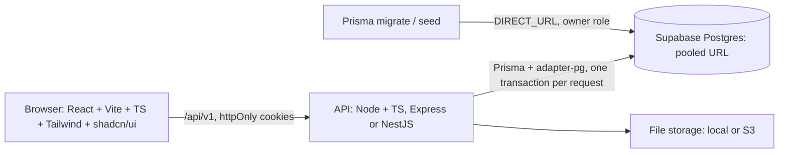
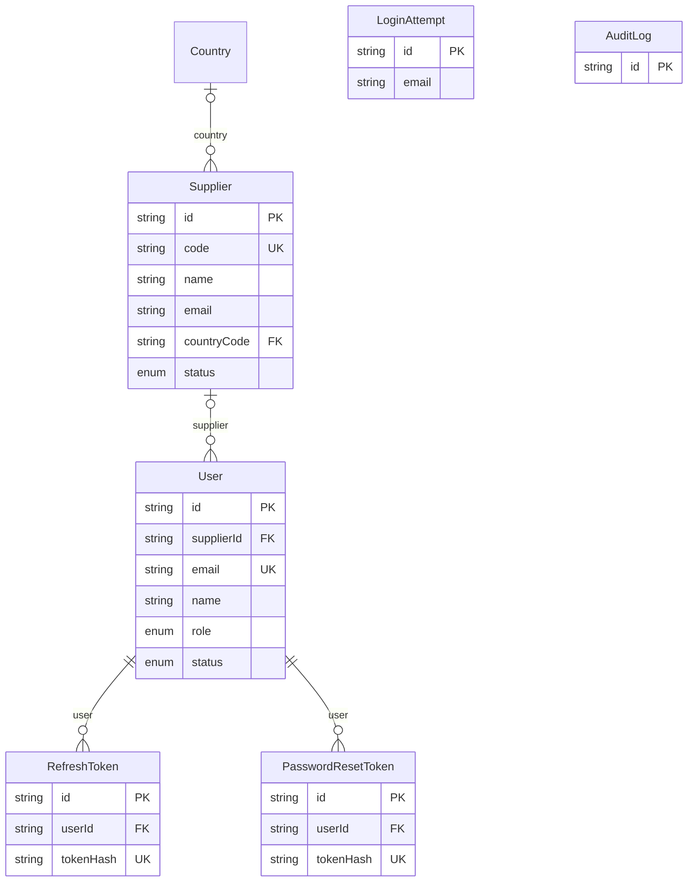
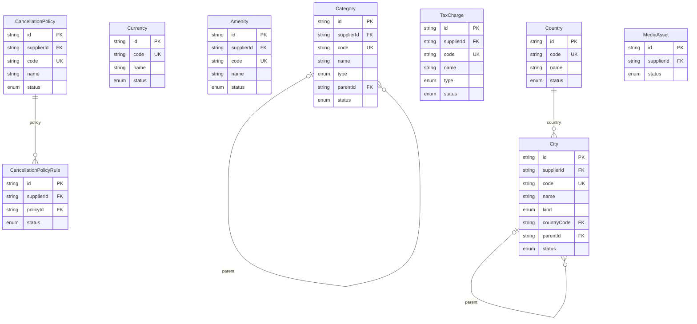
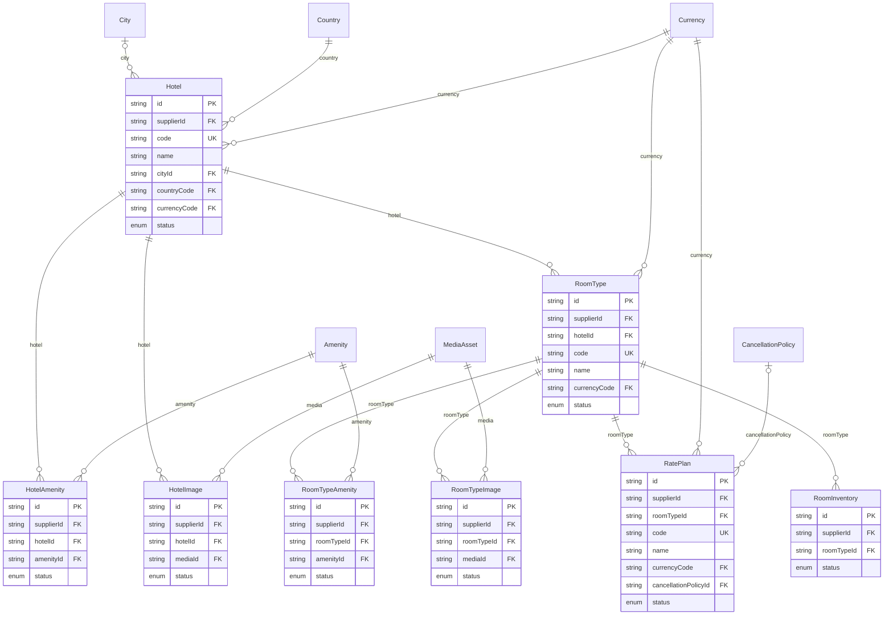
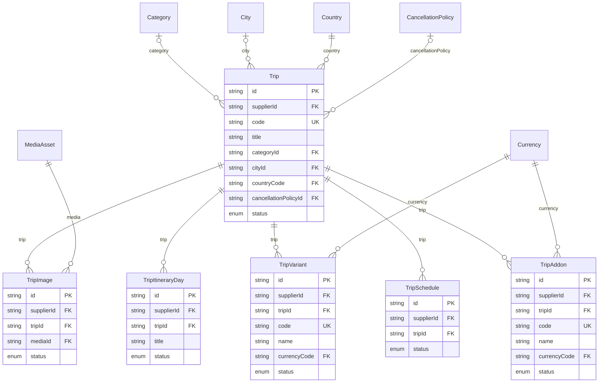
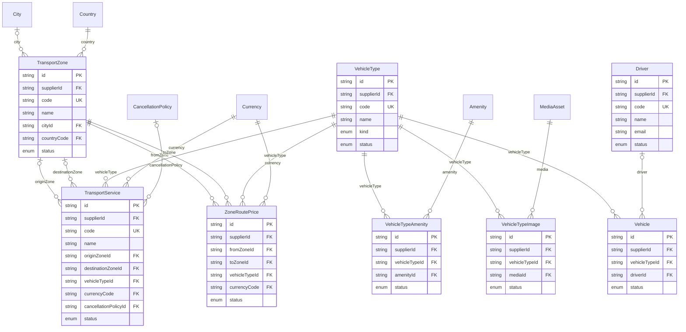
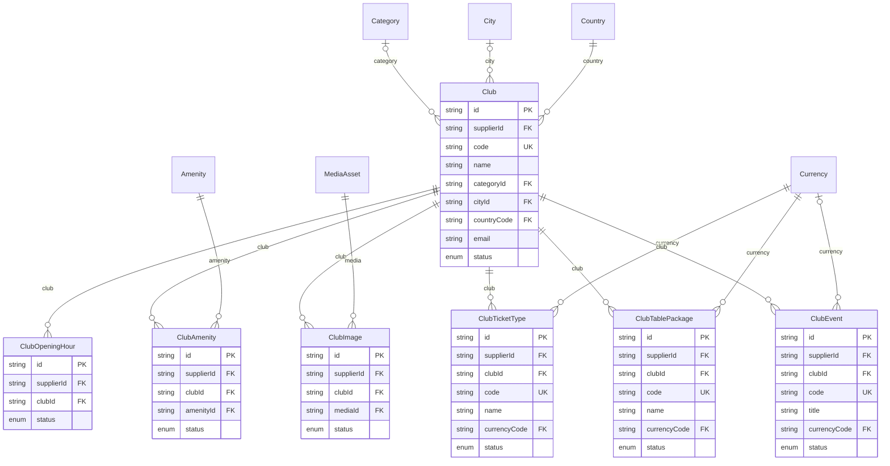

# Booking Admin Back Panel: Architecture and ERD (Steps 1 and 2)

Status: database layer (steps 1-2), backend API (step 3) and frontend (step 4) are done and tested by hand against PostgreSQL 16 (including a scripted browser run). Step 5 (40 backend tests, Dockerfile + docker-compose, README) is done; the Docker files could not be built in the authoring environment.

## 1. Overview



Supabase is used only as managed Postgres. The API does its own authentication (JWT + refresh cookie), so Supabase Auth, PostgREST and the anon/authenticated roles are not used. The migration revokes their access to our tables.

### Proposed backend layout (step 3)

```
apps/api/src/
  config/            env validation (zod)
  common/            tenant context, RBAC guard, errors, response envelope, pagination
  db/                PrismaClient, withTenant() transaction helper
  modules/
    auth/ users/ suppliers/ shared/ (countries, cities, currencies, amenities, categories, taxes, policies, media)
    hotel/ trips/ transport/ club/ audit/ dashboard/ import-export/
apps/web/src/        pages per module, route guards, supplier switcher
prisma/              schema.prisma, migrations/, seed.ts, sql/roles.sql
```

## 2. Multi-tenancy (SupplierID isolation) with defence in depth

1. **JWT is the only source of identity.** `role` and `supplierId` come from the verified access token. A `supplier_id` in a body, query or path is ignored. SUPER_ADMIN may pick a supplier through an `X-Supplier-Id` header, accepted only for that role (the supplier switcher).
2. **Application layer.** Every repository call goes through `withTenant(ctx, fn)`, which injects `supplierId` into `where` and `data`. Controllers never talk to Prisma directly.
3. **Database layer (Row Level Security).** `withTenant` opens one transaction per request and runs
   `SELECT set_config('app.role', $1, true), set_config('app.supplier_id', $2, true)`.
   Every tenant table has FORCE RLS with select/insert/update/delete policies keyed on `app_role()` / `app_supplier_id()`. With no context set, nothing is visible (fails closed). SUPPLIER_STAFF has no DELETE policy, so "create/edit only" is enforced in the database too.
4. **Composite foreign keys.** Tenant-owned relations use `(supplier_id, id)`, so a row cannot reference a parent that belongs to another supplier.
5. **Runtime role.** The API connects as `app_runtime` (non-superuser, no BYPASSRLS, see `prisma/sql/roles.sql`). Migrations and seed use the owner role through `DIRECT_URL`. A superuser or BYPASSRLS connection would silently skip all of the above.

### Shared reference data
A platform pseudo-supplier `SUP-0000` (`is_platform = true`) owns cities, amenities and categories. All tenants can read them through `app_platform_supplier_id()` (SECURITY DEFINER); only SUPER_ADMIN writes. Countries and currencies are global tables (read for any signed-in role, write for SUPER_ADMIN). Suppliers can still create their own tax charges, cancellation policies and media.
Because these shared rows belong to another supplier, they are referenced by plain foreign keys, not composite ones. **The API must check that a referenced city, amenity or category is either the caller's own or a platform row.**

### Database roles seen by RLS
| `app.role` | Access |
|---|---|
| SUPER_ADMIN | all suppliers, all tables |
| SUPPLIER_ADMIN | own supplier: select, insert, update, delete |
| SUPPLIER_STAFF | own supplier: select, insert, update (no delete) |
| SYSTEM | auth service only: look up users, refresh and reset tokens at login (before a tenant is known) |

## 3. Authentication design (implemented in step 3)

- **Login**: email + password (argon2id or bcrypt cost 12). Returns an access JWT (15 min, `Authorization: Bearer` or cookie) and sets the refresh token as an httpOnly, Secure, SameSite=Strict cookie scoped to `/api/v1/auth`.
- **Refresh**: 7-day opaque token, stored hashed in `refresh_tokens`, rotated on every use. Reusing an old token revokes the whole token family.
- **Lockout**: `login_attempts` plus `users.failed_login_count`; 5 failures lock the account for `LOCK_MINUTES`. Per-IP and per-email rate limiting on top.
- **Forgot/reset**: single-use, hashed, short-lived token in `password_reset_tokens`; the response never reveals whether the email exists.
- **CSRF**: SameSite=Strict on the refresh cookie plus a double-submit token for cookie-authenticated mutations.
- **Other**: helmet, CORS allow-list, zod validation on every input, Prisma parameterised queries (no raw SQL with user input), output escaping, upload type/size checks.
- Users: `mustChangePassword` is set for seeded accounts. Non-super users always have a `supplier_id` (CHECK constraint).

## 4. API conventions

Route layout (all under `/api/v1`, Bearer access token except `/auth/*`): `/auth`, `/suppliers`, `/users`, `/audit-logs`, `/dashboard`, and master data as `/<group>/<table>`:
`/shared/{countries,currencies,cities,amenities,categories,tax-charges,cancellation-policies,cancellation-policy-rules,media-assets}`, `/hotel/{hotels,room-types,rate-plans,room-inventory}`, `/trips/{trips,trip-itinerary-days,trip-variants,trip-schedules,trip-addons}`, `/transport/{vehicle-types,transport-zones,transport-services,zone-route-prices,drivers,vehicles}`, `/club/{clubs,club-opening-hours,club-ticket-types,club-table-packages,club-events}`.
Every master-data resource has: `GET /`, `POST /`, `GET /:id`, `PATCH|PUT /:id`, `DELETE /:id`, `POST /:id/restore`, `PATCH /:id/status`, `POST /bulk`, `GET /export?format=csv|xlsx`, `POST /import[?dryRun=true]`. Hotels, room types, trips, vehicle types and clubs also have `GET|PUT /:id/amenities` and/or `/:id/images`. Interactive docs: `/api/docs` (JSON: `/api/v1/openapi.json`).


`/api/v1/<module>/<entity>` with GET list, GET :id, POST, PATCH :id, DELETE :id (soft delete), plus `POST :id/restore`, `PATCH :id/status` and bulk endpoints. Response envelope: `{ success, data, message, errors, meta: { page, limit, total } }`. OpenAPI generated from the zod schemas. Every mutation writes an `audit_logs` row (before/after JSON) in the same transaction.

## 4b. Frontend (apps/web)

React 18 + Vite + TypeScript + Tailwind, with shadcn/ui-style components written locally (`components/ui`, Tailwind + class-variance-authority; no Radix dependency). Server state with TanStack Query, routing with React Router, toasts with sonner.

- **Metadata-driven pages.** `src/generated/resources.ts` is generated from the same data model as the API. One list page, one form, one detail drawer and the amenity/gallery editors render all 29 master-data entities, so a model change means regenerating, not hand-editing 29 screens. Suppliers, users, audit log, media library, dashboard and account are hand-written pages.
- **Session.** The access token lives only in memory; the refresh cookie is httpOnly. On a page reload the app calls `/auth/refresh` (with the CSRF header) to restore the session. A 401 triggers one automatic refresh and retry.
- **Same origin in production.** The refresh and CSRF cookies are `SameSite=Strict`, so serve the web app and `/api` from one origin (reverse proxy), or the browser will not send them. `CORS_ORIGIN` must list the exact origin(s) users open, including `127.0.0.1` vs `localhost`.
- **Route guards.** `RequireAuth` (and forced password change for temporary passwords) and `RequireRole`; buttons the role may not use are hidden, and the API still enforces everything.
- **SUPER_ADMIN supplier switcher** sets `X-Supplier-Id` on every request and clears cached data. Creating tenant data requires choosing a supplier first.
- **Accessibility/responsive.** Labelled fields, `aria-invalid` + inline errors, keyboard-operable dialogs (Esc closes), sortable column headers with `aria-sort`, mobile slide-over navigation, dark/light mode.

## 5. Data model

44 tables: 36 tenant-scoped (all with `supplier_id`, `status`, `created_by`, `updated_by`, `created_at`, `updated_at`, `deleted_at`), plus suppliers, users, auth tables, audit log, countries and currencies.

- Every tenant table has `UNIQUE (supplier_id, code)` where it has a code, and an index on `(supplier_id, status)`.
- Supplier code `SUP-0001` comes from `supplier_code_seq` through a column default. The UUID stays the primary key.
- Soft delete: `deleted_at`. Unique constraints should be treated as including soft-deleted rows (restore instead of re-creating).
- Rate plans for one room type cannot overlap in dates (GiST EXCLUDE constraint, in SQL migration).
- `audit_logs` is append-only (RLS has no update/delete policy and a trigger rejects them even for the owner).
- Opening hours and event times are stored as `"HH:MM"` text; weekday 0 = Sunday.
- Money uses `Decimal(12,2)`; currency is a code reference.

### Entity relationship diagrams
Entity attributes are abbreviated (keys and main fields only). The Prisma schema is the full definition.

### Core: suppliers, users, auth, audit



### Shared master data



### Hotel



### Trips



### Transport



### Club



## 6. Known limitations and things to decide

- The frontend list shows each referenced record's name with one cached request per distinct id (N+1 but cached). Fine at 20 rows per page; add server-side expansion if lists get heavy.
- Image upload in forms goes through the Media library (upload, then attach to a hotel/room/trip/vehicle/club gallery); there is no inline per-field upload.
- Rate-plan/inventory/schedule pages are plain tables: there is no calendar view yet.

- Soft-deleting a parent (for example a hotel) does not soft-delete its children; the UI/API should hide children of deleted parents or delete them explicitly. Decide whether you want a cascade.
- The email sender is a placeholder that logs the reset link (development only). Plug in SMTP/SES/Resend before production.
- The S3 storage driver is written but untested here; local storage is tested. Images are stored with their original bytes (no resize or re-encode).
- An access token stays valid until it expires (15 minutes) even if the user or supplier is disabled right after; refresh is blocked immediately.
- CSV export prefixes formula-like cells with `'` to stop spreadsheet formula injection, so re-importing an exported file keeps that prefix.
- Supplier codes (SUP-0001 ...) come from a sequence, so gaps appear if an insert is rolled back.

- `prisma migrate deploy` could not be run in the build sandbox (engine download blocked). The two migration SQL files were applied directly to a real PostgreSQL 16 and the schema was validated with `prisma validate` and `prisma generate`. Please run `npm run db:migrate` once against your Supabase project and then `npx prisma migrate diff` to confirm there is no drift.
- Check constraints, the EXCLUDE constraint, RLS and triggers live only in SQL migrations, so Prisma does not know about them. Do not run `prisma db push`.
- Cross-tenant references to shared tables (cities, amenities, categories) are not FK-enforced; the API validates them.
- Supabase specifics: use the pooled URL (port 6543, `pgbouncer=true`) at runtime. `set_config(..., true)` is transaction-local, so it is safe with transaction pooling as long as every request uses one transaction.
