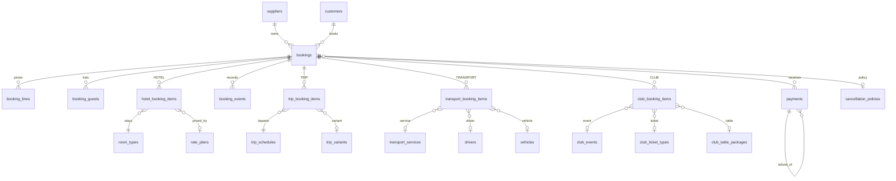
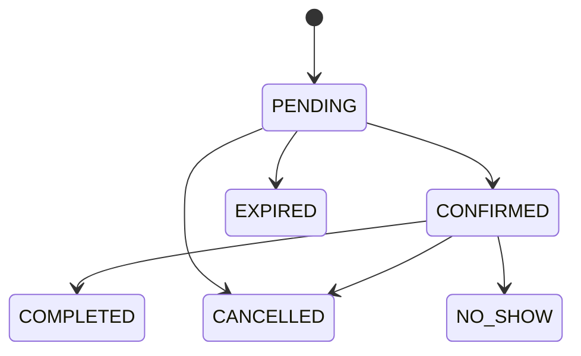

# Booking Admin apps: architecture (steps 1 to 3)

Five back-office apps on top of the existing master-data platform:

| App | Who uses it | Scope |
|---|---|---|
| **Hotel Admin** | Hotel supplier staff and admins | Hotel bookings of one supplier |
| **Trips Admin** | Tour operator staff and admins | Trip bookings of one supplier |
| **Transport Admin** | Transport supplier staff and admins | Transfer and charter bookings, driver dispatch |
| **Club Admin** | Venue staff and admins | Tickets, tables, guest lists, door check-in |
| **Operator Console** | Platform operator (SUPER_ADMIN) | All suppliers and all four products, commission, reports |

The **Master Data panel** now lives in `packages/admin-kit` and is used by all five admin apps. Nothing in the master-data tables changed except one extra unique index on eight tables (needed for the booking foreign keys).

## 1. What is reused, what is new

Reused unchanged: Supabase Postgres + Prisma, the Node/Express API, the JWT + refresh-cookie login, roles (SUPER_ADMIN, SUPPLIER_ADMIN, SUPPLIER_STAFF), supplier isolation from the JWT, row level security with `app_runtime`, the audit log, the response envelope, the generic CRUD engine for master data, and the React/Vite/Tailwind component style.

New:
- **Database** (this step): 11 booking tables, 11 enums, 3 guard triggers, 42 security policies. Migrations `20260102000000_bookings` and `20260102000001_bookings_rls`, generated by `tools/model-gen/bookings.py`.
- **API** (step 3): booking services, status workflow, payments and refunds, inventory holds, availability checks, dispatch, check-in, reports. Routes under `/api/v1` (see section 9).
- **Web** (step 4): `packages/admin-kit` (shared tables, forms, drawer, timeline, API client, auth) and seven Vite apps in `apps/hotel`, `apps/trips`, `apps/transport`, `apps/club`, `apps/operator`, `apps/ops` (staff Ops board) and `apps/guest` (standalone guest app, no admin shell). The API serves each app on its own path (`/hotel`, `/trips`, `/transport`, `/club`, `/operator`, `/ops`, `/guest`) from the same origin, so the SameSite=Strict cookies keep working.
- **Tests, Docker, README** (step 5).

## 2. One booking model for four products

A single `bookings` header table is shared by all products, like an online travel agent. Each product adds its own item table. This keeps list, search, payments, reports and the operator view in one place, while each app only shows its own product.

| Table | Purpose |
|---|---|
| `customers` | Guest address book per supplier (name, email, phone, country). Soft delete. |
| `bookings` | The header: number, product, status, source, guest snapshot, money, payment status, commission, start and end time, hold expiry, cancellation, notes. |
| `booking_lines` | Priced lines: base, add-on, extra, tax, service charge, discount. |
| `booking_guests` | Named travellers or passengers, one marked as lead. |
| `hotel_booking_items` | Hotel, room type, rate plan, check-in and out, nights, rooms, adults, children, nightly rates, room number, check-in and out times. |
| `trip_booking_items` | Trip, variant, departure (schedule), adults, children, prices, pickup address, check-in and show count. |
| `transport_booking_items` | Service, vehicle type, zones, pickup time and address, flight number, passengers, luggage, driver, vehicle, dispatch status and times. |
| `club_booking_items` | Club, event, ticket type or table package (exactly one), visit date, guests, quantity, table label, door check-in count. |
| `payments` | Money in and out. A refund points at the payment it refunds. |
| `booking_events` | Append-only timeline: created, status changes, notes, payments, assignments, check-ins. |
| `booking_sequences` | Counter per supplier, product and month for numbers like `HTL-2611-0004`. |

Money columns are `DECIMAL(14,2)` in the booking currency. Booking numbers are unique per supplier.

## 3. Rules enforced in the database

These hold even if the API has a bug.

- **Status machine.** `PENDING` goes to `CONFIRMED`, `CANCELLED` or `EXPIRED`. `CONFIRMED` goes to `COMPLETED`, `CANCELLED` or `NO_SHOW`. Everything else is final. A booking's product and supplier never change.
- **Totals add up.** `total = subtotal + tax + service charge - discount`. A cancelled booking must have a cancellation time.
- **Item belongs to the right product.** A club item cannot hang off a hotel booking, and so on.
- **Product checks.** Hotel `nights = check_out - check_in`. A club item has a ticket or a table, never both. Door check-in count cannot exceed guests. A driver must be set once a transfer is assigned.
- **Payments drive the balance.** `paid_amount` and `payment_status` (UNPAID, PARTIAL, PAID, PARTIALLY_REFUNDED, REFUNDED) are recalculated by a trigger from successful payments and refunds. Nobody types them in.
- **Refund limits.** A refund must point at a successful payment of the same booking and cannot exceed it.
- **Timeline is append-only.** Updates and deletes on `booking_events` are blocked.
- **Master data stays safe.** Booking items reference hotels, rooms, trips, vehicles and clubs with `ON DELETE RESTRICT`. Something with bookings can only be soft deleted.

Status flow:

## 4. Tenancy and roles

Same model as master data: the supplier comes from the verified JWT, every request runs in one transaction that sets `app.role` and `app.supplier_id`, and every booking table has FORCE row level security. Composite foreign keys `(supplier_id, id)` make cross-supplier links impossible.

| Action | SUPER_ADMIN (Operator) | SUPPLIER_ADMIN | SUPPLIER_STAFF |
|---|---|---|---|
| See bookings | All suppliers | Own supplier | Own supplier |
| Create, edit, add notes, confirm | Yes | Yes | Yes |
| Record a payment | Yes | Yes | Yes |
| Issue a refund, cancel a confirmed booking | Yes | Yes | No (database refuses refunds) |
| Edit or void a payment | Yes | Yes | No |
| Delete (soft) a booking | Yes | Yes | No |
| Dispatch, check-in, guest list | Yes | Yes | Yes |
| Commission and revenue reports | All suppliers | Own supplier | No |

Behaviour to know: when security blocks an update or delete, Postgres reports 0 rows changed instead of an error. The API treats 0 rows as 403 or 404.

## 5. Behaviour the API will add (step 3)

- **Create** runs in one transaction: validates availability, prices from rate plan, variant, service or ticket, writes lines and items, takes a hold, writes the first timeline event. Pending bookings get `hold_expires_at`; a sweeper marks overdue holds `EXPIRED` and releases inventory.
- **Inventory.** Hotel: `room_inventory.available_units`. Trip: `trip_schedules.remaining_quota`. Club: event or ticket quota. Transport: driver and vehicle clash check for the pickup window. Holds take stock, cancel and expiry give it back, with `SELECT ... FOR UPDATE` to stop overbooking.
- **Cancel** applies the booking's cancellation policy (refund percent by hours before start) and proposes the refund; an admin issues it.
- **Commission** is snapshotted on the booking from the supplier's `commission_pct` when it is created, so later rate changes do not rewrite history.
- **Every write** also goes to the existing audit log.
- **List endpoints** share one shape: filters (status, payment status, dates, source, search by number, guest, email, phone), sort, pagination, CSV export.

## 6. Screens per app

All five apps share: Dashboard, Booking list, Booking detail, New booking, Customers, Payments, Calendar, Reports.

- **Booking list.** Search, status and payment chips, date range, source, product-specific columns, bulk confirm and export.
- **Booking detail.** Header with status actions, guest and contact card, items, price breakdown, payments and refunds, guests, timeline with notes, internal notes, cancel dialog with refund preview.
- **Hotel Admin.** Arrivals and departures today, in-house list, room availability board, check-in and check-out with room number.
- **Trips Admin.** Departures calendar, manifest per departure, remaining quota, mark show or no-show.
- **Transport Admin.** Dispatch board (today and tomorrow), assign driver and vehicle with clash warning, trip progress (assigned, on the way, picked up, dropped off).
- **Club Admin.** Tonight's guest list, door check-in with count, table map list, event bookings.
- **Operator Console.** All bookings across suppliers with supplier and product filters, revenue and booking volume, commission due per supplier, cancellation rate, payments and refunds overview, supplier drill-down.

## 7. Delivery steps

1. Architecture and ERD (this document).
2. Booking schema, migrations, security, demo data. **Done:** see below.
3. API: bookings, payments, workflow, inventory, dispatch, reports, OpenAPI. **Done:** see section 9.
4. Web: `admin-kit` and five apps, plus a clickable preview.
5. Tests, Docker (serves all apps), README.

## 8. What step 2 delivered and how it was checked

- `tools/model-gen/bookings.py` writes both migrations and the Prisma models. Running it twice gives the same files.
- A fresh database builds from all five migrations. `prisma validate` passes. 201 security policies in total (42 new).
- `prisma/seed-bookings.ts` (`npm run db:seed:bookings`) creates 8 customers and 23 bookings per demo supplier across all products and statuses, with payments, refunds and a timeline.
- 23 database checks ran as the non-superuser runtime role: isolation between suppliers, illegal status moves, wrong-product items, nights and ticket rules, refund limits, payment totals syncing, staff blocked from refunds, deletes and payment edits, append-only timeline, and no data without a context. All pass.

Limits so far: `prisma migrate deploy` has not been run (the sandbox cannot download Prisma engines), so migrations were applied with `psql` in order. The API, screens and Docker changes are not built yet.

## 9. What step 3 delivered (the API)

Code is in `apps/api/src/booking/`: `schemas.ts` (input rules), `create.ts` (pricing and stock), `lifecycle.ts` (status, cancel, payments, check-in, dispatch), `read.ts` (lists, detail, boards, availability, overview), `reports.ts`, `router.ts`, `sweeper.ts`. All endpoints are in the OpenAPI document at `/api/docs` under the tag **Bookings**.

| Area | Endpoints (under `/api/v1`) |
|---|---|
| Bookings | `GET/POST /bookings`, `GET /bookings/export` (CSV), `GET /bookings/calendar`, `GET/PATCH/DELETE /bookings/:id`, `POST /bookings/:id/restore` |
| Workflow | `POST /bookings/:id/status`, `/cancel`, `GET /bookings/:id/cancel-preview`, `POST /bookings/:id/notes` |
| Money | `POST /bookings/:id/payments`, `/refunds`, `POST /payments/:id/void`, `GET /payments` |
| Operations | `POST /bookings/:id/check-in`, `/check-out`, `/assign`, `/dispatch` |
| Customers | `GET/POST /customers`, `GET/PATCH/DELETE /customers/:id` |
| Look-ups | `GET /availability/hotel|trips|transport|club`, `GET /boards/hotel|trips|transport|club`, `GET /booking-overview` |
| Reports (admins) | `GET /reports/summary`, `/reports/commission`, `/reports/payments` |
| Operator | `POST /bookings/expire-holds` |

How it behaves:
- **Price is computed by the server** from the rate plan, trip variant, transport service or zone route, and ticket or table. The client cannot send a price. Non-inclusive taxes come from the supplier's tax and charge records. Commission is copied from the supplier at creation.
- **Stock.** Hotel: one atomic update per night that must succeed for every night. Trip: atomic update of `remaining_quota`. Club: counted from live bookings under an advisory lock. Transport: driver and vehicle clash window (`TRANSPORT_CLASH_MINUTES`, default 180).
- **Holds.** A pending booking holds stock for `BOOKING_HOLD_MINUTES` (default 60). A background sweeper (`HOLD_SWEEP_SECONDS`, default 60, 0 turns it off) expires overdue ones and gives stock back.
- **Cancel** uses the booking's policy (largest `hoursBeforeStart` not above the hours left) and refunds across the original payments. Staff can cancel only an unpaid pending booking.
- **Roles.** Staff cannot give discounts, refund, void payments, delete, cancel a confirmed booking or open reports. The operator must send `X-Supplier-Id` to create a booking or customer.
- Club bookings send the head count as `guestCount` (the named guest list is `guests`, same as the other products).
- Day boundaries use `BOOKING_TZ_OFFSET_MINUTES` (default 480, Bali).

Checked: `tsc` passes; 25 new API tests plus the 40 existing ones pass (65) against a migrated and seeded database as the non-superuser role. The new tests cover pricing and holds for all four products, overbooking (parallel requests never exceed stock), part payments, policy cancellation and stock release, the status machine, staff limits, isolation between suppliers, hold expiry, check-in, dispatch with a clash, CSV formula safety and reports.

Not done or not checked: `prisma migrate deploy` (migrations applied with `psql`), Docker build, load testing, and editing the items of a booking (cancel and rebook instead). Hold expiry sends no message to the guest.

## 10. Guest concierge bookings

Guests of the hotel book through the **Booking** menu of the Guest Concierge app. Four of its sub menus save a booking, all into the one `bookings` table. There is no separate guest concierge menu in the admin apps: these bookings sit in each app's normal **Bookings** list, and the **Source** filter set to "guest concierge" narrows the list to them.

| Booking sub menu | Saved as | Shows up in |
|---|---|---|
| Hotels | `HOTEL` booking | Hotel Admin |
| Trips | `TRIP` booking | Trips Admin |
| Transport | `TRANSPORT` booking | Transport Admin |
| Club | `CLUB` booking | Club Admin |
| My Stay > Explore: Spa, Activities, Kids club | `EXPLORE` rows in the hotel ops board | **Hotel Ops Board > Bookings** (not the booking admin) |
| Restaurants, dining, housekeeping, chat | not saved as bookings | stay with the hotel and the restaurant |

How it works:
- **API.** The app calls `POST /api/v1/bookings` with `source: "CONCIERGE"` and `roomNumber`. It signs in as a staff account of the supplier, so the normal tenant rules apply. No new endpoint.
- **Rules.** A room number is required. `confirm: true` is refused, so a booking always starts as `PENDING`. It holds stock for `CONCIERGE_HOLD_MINUTES` (default 480) and the sweeper expires it if nobody answers. Staff confirm or cancel it in the booking detail like any other booking.
- **Numbers.** `HTL-`, `TRP-`, `TRN-` and `CLB-` plus year and month, from the existing `booking_sequences` counter.
- **Payment.** The new method `ROOM_CHARGE` records that the amount goes on the guest's room bill.
- **OTA.** `OTA` is no longer accepted when creating a booking. Old rows keep it and the list filter still understands it.
- **Operator Console.** The same bookings appear in All bookings, with the product and supplier filters.
- **Database.** Migration `20260102000002_concierge`: enum values `CONCIERGE` and `ROOM_CHARGE`, column `bookings.room_number`.
- **Demo.** The preview of the guest app keeps its rows in the browser (one table, same fields as the API) because it cannot call the API from here.

**Two destinations, no overlap.** The booking admin tables receive only Hotels, Trips, Transport and Club. The Hotel Ops Board **Bookings** tab receives only the Explore sources: Spa (`SPA-`), Activities (`ACT-`) and Kids club (`KID-`), each with room number, guest, price and status Requested, Confirmed or Cancelled. Hotel staff confirm them there. The Ops Board no longer lists hotel, trip, transport, club or restaurant bookings, and its club ticket sales block was removed from that tab.

Checked: 4 new API tests, 69 of 69 pass.

**Manual bookings and master data on the Hotel Ops Board.** The Bookings tab has **+ New booking** for a guest who asks at the desk or by phone. Types: Spa, Activities, Kids club and Promotion. Each row gets the next reference (`SPA-`, `ACT-`, `KID-`, `PRM-`), is charged to the room, and shows "Created by <role>" as its source. Rules: the item must be active in master data; places per day are checked (a full day is refused); kids club needs a child aged 4 to 12; a requested service creates a confirm task for its department; a promotion is booked at once, takes one spot and creates its task.

A **Master data** tab holds the lists behind the board: services (spa, activities, kids club), promotions, dining menu, staff, request types and rooms. Only the front desk and the general manager can change them; other roles view only. Items are deactivated rather than deleted, so old bookings and orders keep their names; an inactive item disappears from new-booking, menu, staff-assignment and request lists. Rooms can be added and removed. Fields are validated (required, length, range, unique name).

Demo only: the board keeps this in the page. The real version needs `ops_services`, `ops_promotions` and related tables with the same fields, plus `POST /api/v1/ops/bookings`.

**Integration map: Hotel Ops Board master data and the Guest Concierge app.** Each guest-app screen reads one master list. Today the two previews are separate pages, so the link is by design only; the real build reads these lists through the API (`GET /api/v1/guest/...`) and the board writes them (`/api/v1/ops/master/...`).

| Guest app screen | Master data list | Fields the guest app uses |
|---|---|---|
| My Stay > Explore (Spa, Activities, Kids club) and Main > Recommended for you | Services | category, name, description, price, per person, duration, places per day, children only, active, photo |
| My Stay > Explore > Promotion | Promotions | category, name, description, price, offer text, valid when, suggested for, spots per day, active, photo |
| Explore section headers | Explore sections | display name, description, hours, good to know lines |
| My Stay > Dining | Dining menu | icon, category, name, description, price, tags, active |
| My Stay > Services (quick requests) | Request types | icon, name, department, status steps, what the guest fills in, shown in guest app |
| Task assignment, request routing | Staff, Departments | name, department, active |
| My Stay header ("Room 412 · Deluxe Garden View") | Rooms, Room types | room number, type, beds, sleeps |
| Hotel Info > About | About, Good to know | name, description, check-in, check-out, Wi-Fi network and password, notes |
| Hotel Info > Restaurants | Restaurants | icon, name, hours, description, tags |
| Hotel Info > Facilities | Facilities | icon, name, hours, description |
| Hotel Info > Contact | Contact and policies | title, text |
| My Stay > Main > Information | Announcements | icon, title, text, show until |
| Main (Home) > Events | Hotel events | name, day, time, venue, about |
| Profile > interests and diet | Guest preferences | type, name |
| Booking forms | Booking rules | free cancellation hours, booking window, service charge, hold minutes, charge to room |

Not hotel master data, on purpose: Home "Offers and ads" (sponsored partner placements, managed by the operator), and the Booking tab's Hotels, Restaurants, Trips, Transport and Club (managed in the booking admin of each business).

Open gaps: lists are shared by both hotels in the preview and need a hotel id in the real tables; Wi-Fi password is shown only after My Stay sign-in; photos need the upload endpoint.

**My Stay tables (guest app to Hotel Ops Board).** Besides Explore bookings, My Stay now saves four more tables with the same fields the Ops Board shows. Refs: `RQ-` request, `DO-` dining order, `AX-` access request, `FB-` feedback.

| Guest app action | Row | Ops Board screen | Status mapping |
|---|---|---|---|
| Quick request (towels, late checkout, ...) | `RQ-yymm-nnnn`: type, department, room, guest, notes, source `GUEST_APP` | Guest requests | first step = To Do, last step = Done, steps between = In Progress. The board shows "Guest sees: <step>" using the request type's status steps |
| Dining order | `DO-yymm-nnnn`: items (name, qty, price), subtotal, service charge percent, total, deliver when, notes, source `GUEST_APP` | Room dining | the same names as the board: Received, Preparing, On the way, Delivered |
| Sign-in request | `AX-yymm-nnnn`: hotel, title, last name, booking ref, room, phone | Guest access | PENDING, CONFIRMED (code issued), DECLINED, SIGNED_IN |
| Do not disturb | one row per room: room, on or off, updated at | Rooms (DND mark) and Guest requests (note on housekeeping requests) | none |
| Feedback | `FB-yymm-nnnn`: rating, comment, room, guest | Report (list and average), Manager alerts for 3 stars or less | none |

Shared values now read from one place in each page: check-in and check-out time, Wi-Fi, service charge percent and booking window.

**Booking tab to Operator Console.** The four booking rows (HOTEL, TRIP, TRANSPORT, CLUB) now carry what the booking admins need, not only a text line:

| Field | Meaning |
|---|---|
| `supplier` | the company that provides the product (Tide Events, Ubud Heritage Tours, ...). The Operator Console uses it to route the booking to the right supplier admin |
| `item` | structured detail. HOTEL: hotel, room, check-in, check-out, nights, guests. TRIP: trip, date, guests, note. TRANSPORT: service, pickup time, pickup, drop-off, passengers. CLUB: event, product, quantity, visit date, ticket name |
| `guestType` | `IN_HOUSE` (signed in to My Stay, has a room) or `VISITOR` (not staying) |
| `contact` | name and mobile for visitors |
| `paymentMethod` | `ROOM_CHARGE` for in-house guests; visitors pay through the concierge (`ARRANGE_WITH_CONCIERGE`), so room charge is not offered for them in the admin |
| `holdMinutes` | how long an unconfirmed booking is held (480, from Booking rules) |

In the admin previews, guest-concierge bookings now show a "Visitor, not staying" case beside the in-room case, the hotel the guest asked from, and the payment dialog hides Room charge for visitors.

Not built yet (real API, step 4): the `requested_by_hotel` column, `guest_type`, and accepting `item` for CONCIERGE bookings. Restaurant table requests from the Booking tab have no booking table yet.

## Booking emails (guest and supplier)

Every booking created through the API queues one email per recipient (GUEST, SUPPLIER) in the `email_outbox` table, inside the same transaction as the booking. If the booking commits, the emails exist; if it rolls back, they do not.

- Guest row is `SKIPPED` when the booking has no guest email. A `NOTIFICATION` event is written to the booking timeline.
- A sender (`startMailer`, every `EMAIL_SEND_SECONDS`, 0 = off) delivers `QUEUED` rows, retries up to 5 times, then marks `FAILED`. Subjects are stripped of CR/LF.
- Routes: `GET /bookings/:id/emails` and `POST /bookings/:id/emails/:emailId/resend` (optional `toEmail`).
- Env: `MAIL_FROM`, `NOTIFY_GUEST_EMAIL`, `NOTIFY_SUPPLIER_EMAIL`, `EMAIL_SEND_SECONDS`.
- The `mailer` in `apps/api/src/mail.ts` only logs. Connect SMTP or Resend there before going live.
- Admin previews: Settings > Booking has a "Booking emails" card (guest / supplier switches).
- Guest app: visitors can enter an optional email; signed-in guests use their reservation email. Rows carry `guestEmail`, `supplierEmail`, `emails[]`.

## Booking dates (guest app Booking tab)

Hotels: check-in and check-out date inputs (check-out after check-in, up to 30 nights). Trips: `item.date`. Transport: `item.pickupDate` and `pickupTime`. Dates must be today up to 6 months ahead.

## PMS integration (OPERA Cloud, VHP) and the Front desk tab

The Ops Board has a Front desk tab (arrivals, departures, guests in house, with a date from/to filter) and a Rooms tab that shows the guest, arrival and departure for each room, filtered by housekeeping room status and front office status (Vacant, Due in, Occupied, Due out, Checked out). In the preview these read a sample reservation list. In production the PMS is the source of truth for guests, dates and room assignment.

**Adapter.** The API defines one `PmsAdapter` interface per hotel, with an `OperaCloudAdapter`, a `VhpAdapter` and a `NullAdapter` (sample/manual mode):

- `listReservations({ from, to, kind })` for arrivals, departures and in-house
- `getReservation(ref)` used by guest access (is the guest checked in, valid, in this room)
- `listRoomStatus()` and `setRoomStatus(room, status)` (housekeeping)
- `checkIn(resId, room)` and `checkOut(resId)`
- `postCharge(resId, { code, amount, description })` for room dining, spa and other room charges

**Tables to add at build time** (all tenant-scoped with RLS like the rest): `pms_config` (provider, hotel code, base URL, client id, name of the server secret, sync minutes, read/write switches), `pms_reservation` (pms id, booking ref, guest, room, arrival, departure, adults, children, status, source, last seen), `pms_room_state` (room, housekeeping status, front office status), and `pms_outbox` (queued writes with attempts, like `email_outbox`). Sync is a poller (and Business Events webhooks for OPERA when available) that upserts into these tables; writes go through the outbox so a PMS outage never blocks the desk.

**Mapping.**

| This app | OPERA Cloud (OHIP) | VHP |
|---|---|---|
| Arrivals, departures | Reservations API by arrival or departure date | Reservation list by date (confirm with the vendor) |
| In house | Reservations with status In House, with room number | In-house guest list |
| Room status | Housekeeping API | Room status |
| Check-in, check-out | Front Desk API | Check-in / check-out calls |
| Room charges | Cashiering API, post to folio | Post charge to room |
| Sign-in | OAuth 2 client credentials, app key, hotel code | Per vendor |

Endpoint names are the planned mapping. Confirm them against the hotel's own OHIP subscription and VHP interface before building. Credentials are never stored in the database or typed into the browser: `pms_config` holds only the name of the environment variable.

**Guest access.** The guest-access check (checked in, valid booking, room matches) reads `pms_reservation`, not a separate table. In the preview it reads the same sample reservations as the Front desk tab.

**Preview limits.** Master data > PMS integration only saves settings. "Sync now" and the activity list are simulated and nothing is sent anywhere. Room tile taps and check-in/out change local data only.

## Channel manager and booking engine (Hotel admin)

Goal: one place to set stock, rates and rules; open channels (OTAs) and the direct booking engine both read from it, and every reservation, from any source, takes stock from all of them.

**Preview (simulated).** Hotel admin nav groups "Channel manager" (Channels, Rates and restrictions, Channel mapping, Sync log) and "Direct booking" (Booking engine, Promo codes). Channel connections, pushes and OTA reservations are simulated in the browser. The widget is a working preview that creates real `WEBSITE` bookings in the preview data.

**Planned data model (API step).**
- `channel_connection(id, tenant_id, hotel_id, provider, property_ref, status CONNECTED|PENDING|DISCONNECTED|ERROR, is_open, commission_pct, price_adjust_pct, push_mode FULL|AVAIL, import_reservations, last_sync_at, last_error, secret_ref)`. Credentials only as a server secret name (`secret_ref`), never in the table or the browser.
- `channel_room_map(connection_id, external_code, room_type_id)` and `channel_plan_map(connection_id, external_code, rate_plan_id)`.
- `rate_calendar(room_type_id, date, rate, min_stay, closed_to_arrival, closed_to_departure)` next to the existing `room_inventory(total, stop_sell)`.
- `channel_sync_log(id, connection_id, type, direction, status SUCCESS|FAILED|SKIPPED, message, attempts, error, created_at)`. Pushes go through an outbox with retry (same pattern as `email_outbox`).
- `bookings.channel_id`, `bookings.channel_ref`, `bookings.channel_commission_pct`; `source = 'OTA'`. Reservation import is idempotent on `(connection_id, channel_ref)`; unmapped rooms or plans fail into the log, never drop.
- `promo_code(code, pct, valid_from, valid_to, min_nights, status)`, `booking_engine_settings(hotel_id, enabled, pay_mode, deposit_pct, min/max stay, advance_days, same_day_cutoff, direct_discount_pct, theme, allowed_domains, public_key)`.
- Adapter interface `ChannelAdapter` (Booking.com, Expedia, Agoda, Traveloka) or a single aggregator. Endpoint names must be confirmed with each partner programme.

**Rules.** Stock = total rooms minus live bookings from every source, so a direct or OTA booking pushes new availability to all other open channels. Channel price = base rate x (1 + adjustment). Direct price = base x (1 - direct discount); the better of a promo code and the direct discount applies, not both. A parity warning shows when an open channel is cheaper than direct.

**Public widget API (planned).** Public key plus allowed-domain check, rate limited, no tenant JWT:
`GET /public/v1/hotels/:slug/availability`, `POST .../quotes`, `POST .../bookings`; the widget script is `widget.js` with `data-hotel`, `data-key`, `data-target`. Payments for deposit or full mode go through the payment provider; the preview only records a payment.

## Integration layer
Connections, the PMS mirror, event outbox, API keys and webhooks are specified in `INTEGRATION.md` (built and tested in the API, 12 tests). The Hotel admin has an Integrations page and the Operator console an Integration health page (preview, simulated).

## Ops board and Guest concierge (built)
Code: API in `apps/api/src/ops/` (`router.ts` staff, `guest.ts` guests, `kb.ts` search, `shared.ts` service catalogue and SLA), apps in `apps/ops` and `apps/guest`, migration `20260104000000_ops_guest`, demo data `prisma/seed-ops.ts`. All endpoints are in the OpenAPI document at `/api/docs`.

- **Tables** (all with `supplier_id` and row level security): `ops_staff`, `ops_room`, `ops_task` (kind TASK or REQUEST, status, priority, history, source STAFF or GUEST_APP), `dining_item`, `dining_order`, `kb_doc`, `shift_note`.
- **Guest sign-in:** `POST /api/v1/guest/auth` with booking number and last name calls the SQL function `guest_find_stay` (SECURITY DEFINER). It matches a CONFIRMED hotel booking from the day before check-in until check-out. The token is separate (audience `booking-admin-guest`), lasts `GUEST_TOKEN_HOURS` (12) and works only on `/guest/*`. Each call re-reads the booking, so a checked-out guest is locked out at once. Sign-in is limited to 15 per 15 minutes.
- **Requests:** a guest request becomes an `ops_task` for the right department with a target of 15 minutes (urgent) or 30, and emits `request.created`. The guest sees progress steps derived from the task status. Requests and orders need a room number, so the guest must be checked in.
- **Room dining:** the server prices orders from the menu; the guest cannot set prices. Staff move orders NEW, PREPARING, ON_THE_WAY, DELIVERED.
- **Assistant:** `POST /guest/assistant`. With `ANTHROPIC_API_KEY` the model gets the stay details and the knowledge base documents (best matches first, 24k characters) and answers in the guest's language. Without it, keyword search over the same documents. Voice input and read-aloud use the browser Web Speech API.
- **Roles:** staff work tasks, rooms, orders and shift notes and may toggle duty and menu availability; admins manage staff, rooms, menu and knowledge base.

Not ported from the original Ops artifact: checklists, promotions, feedback ratings, guest-access confirmation, front desk and bookings tabs. Known gaps: duplicate booking numbers across suppliers are not disambiguated at sign-in; the AI path is tested with a mocked call only.
